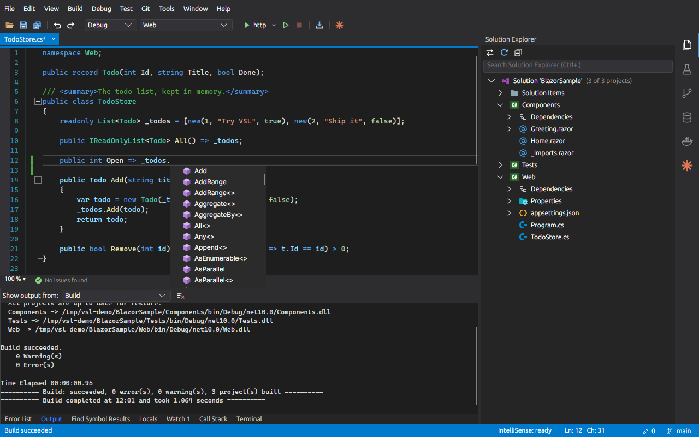
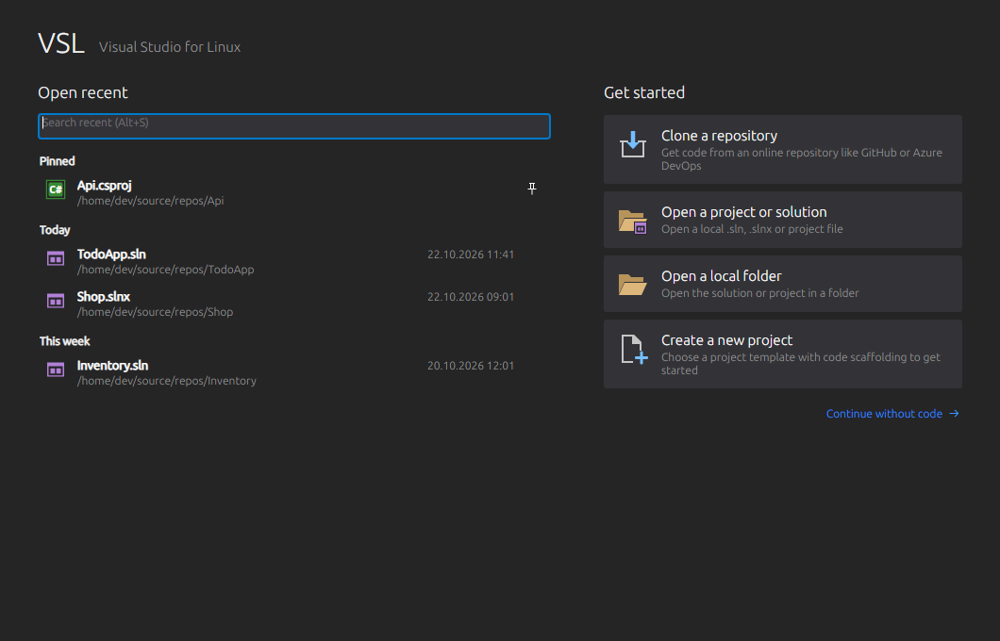
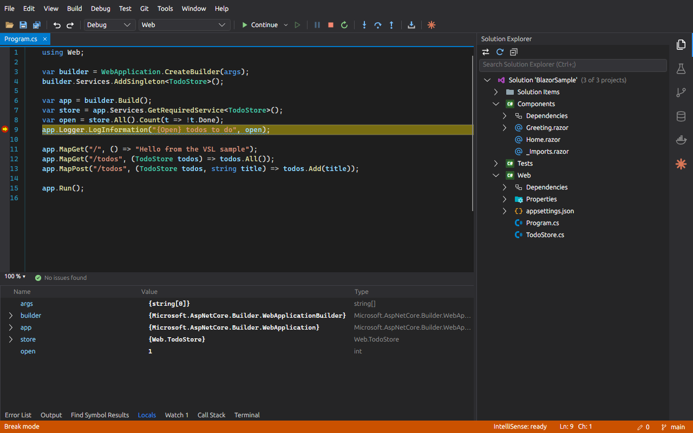
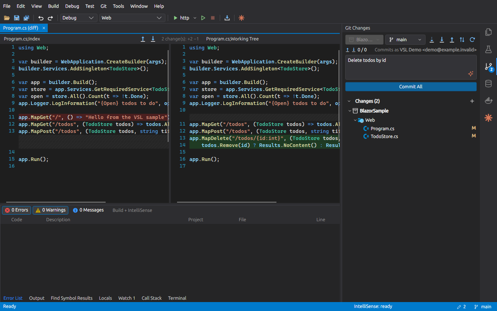
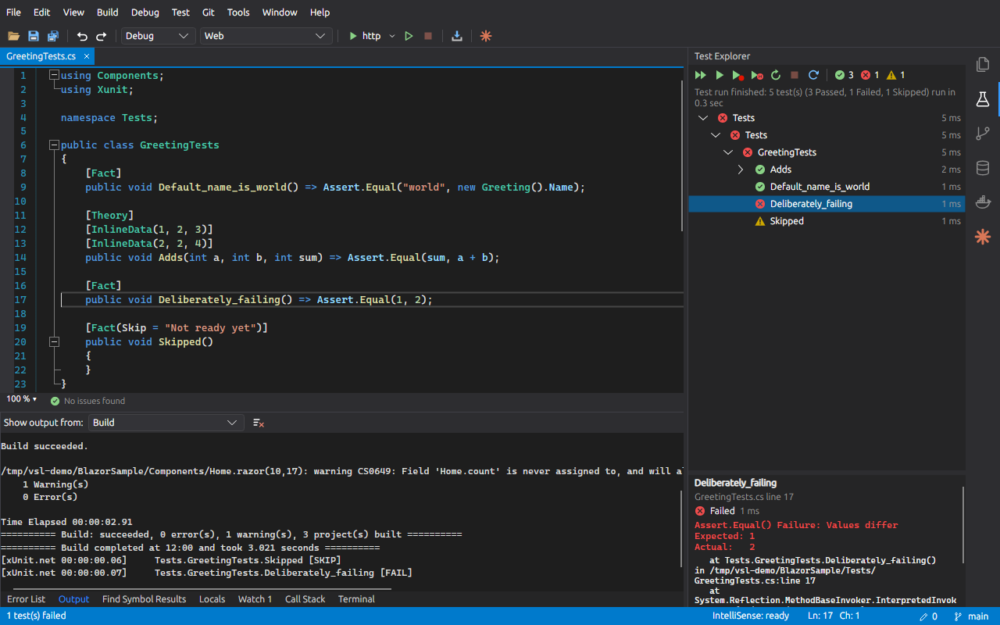
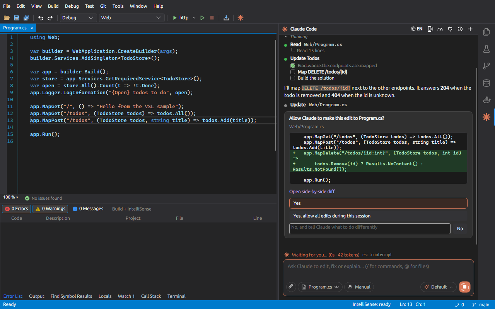
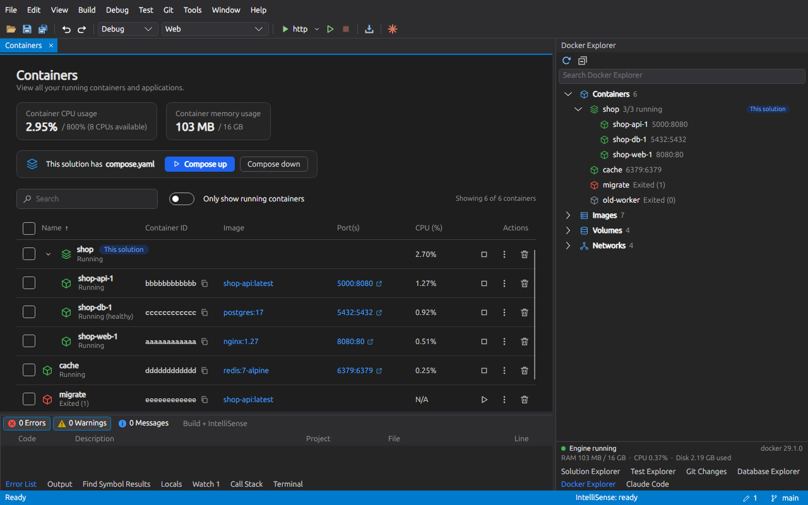
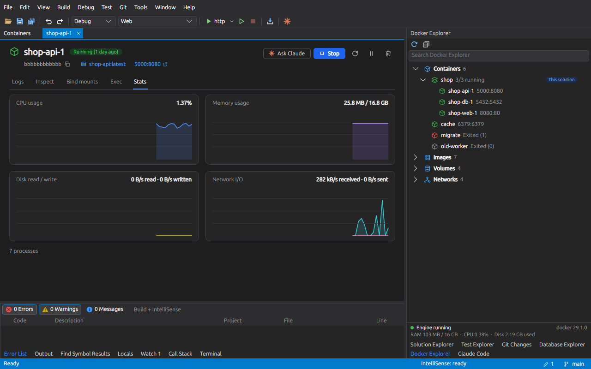
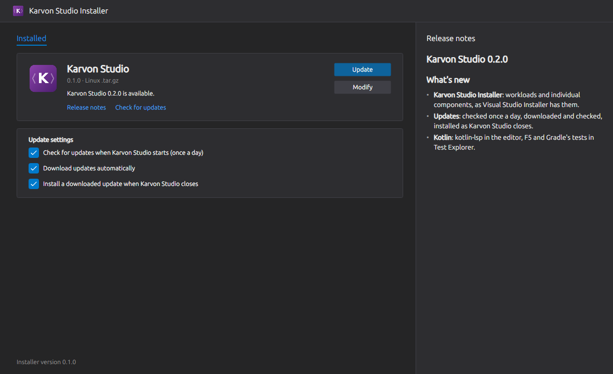
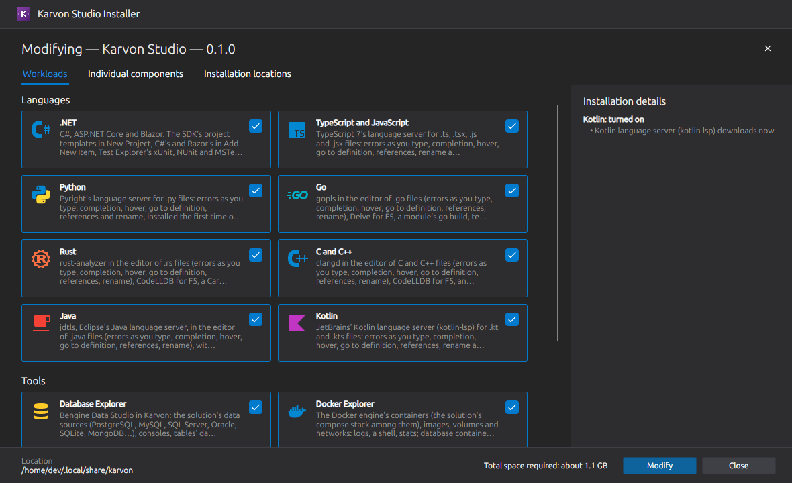

# Karvon Studio

A native IDE with Visual Studio's look and workflow, made to grow by modules: C#, ASP.NET Core and Blazor, TypeScript
and JavaScript, Python, Go, Rust, C and C++, Java and Kotlin on Linux; macOS and Windows next ([roadmap](ROADMAP.md)). Built
with Avalonia, its C# IntelliSense is Microsoft's Roslyn, the engine Visual Studio uses. It grew out of VSL, whose
history this repository carries.



| | |
|---|---|
|  |  |
| **Start window**: recent solutions, clone, open a folder | **New project**: `dotnet new`'s templates and the languages' own |
|  |  |
| **Debugging**: breakpoints, stepping, Locals, Watch, Call Stack | **Git**: Changes window, side-by-side diff, branches |
|  |  |
| **Test Explorer**: run and debug every language's tests | **Claude Code** in a tool window, with diffs and approvals |
|  |  |
| **Docker Explorer**: containers, images, volumes, networks | **A container's page**: logs, inspect, a shell, live stats |
|  |  |
| **Karvon Studio Installer**: the installed version, its update | **Modify**: workloads and individual components, as in VS |

## Install

Download the [latest release](https://github.com/karvon-studio/karvon/releases/latest) (Linux x64; no .NET runtime needed):

```bash
sudo apt install ./karvon-studio_*_amd64.deb                                   # Debian/Ubuntu
chmod +x Karvon-Studio-*-x86_64.AppImage && ./Karvon-Studio-*-x86_64.AppImage   # any distribution
```

Then `karvon path/to/App.sln` (or a `.slnx`, a project, a folder), or `karvon` for the start window. Solutions need the
.NET 10 SDK; the language servers and debuggers download the first time they are needed (Tools > Get Tools and Features
lists them). Karvon Studio updates itself: it checks once a day and installs the update as it closes.

## What it does

- **Editor**: IntelliSense, quick actions, refactorings, Go To Definition, Find All References, Rename, outlining.
- **Solutions and folders**: `.sln`, `.slnx`, a project, or any folder with its `tasks.json`, `launch.json` and
  `package.json` scripts.
- **Build, run, debug and test** each language, with the Error List and Test Explorer.
- **Git**, **Terminal** and **NuGet**.
- **Database Explorer**, **Docker Explorer**, **Servers** (SSH), **MCP Servers** and **Skills**.
- **Claude Code**, your own `claude` CLI, with Karvon's tools: the build, the tests, the debugger, the databases.
- **Karvon Studio Installer** (`karvon --installer`, or Tools > Get Tools and Features) and **updates**.

The details, language by language, are in [docs/features.md](docs/features.md); how a module plugs in is in
[docs/modules.md](docs/modules.md).

## Development

```bash
git clone --recursive https://github.com/karvon-studio/karvon   # bengine, the Database Explorer's engine, is a submodule
dotnet build Karvon.slnx
dotnet tests/Karvon.Tests/bin/Debug/net10.0/Karvon.Tests.dll   # the tests
./scripts/install.sh                                            # installs into ~/.local/share/karvon/app and adds `karvon`
```

`src/Karvon.Core` is the workbench and knows no module; each module is a project beside it (`src/Karvon.DotNet`,
`src/Karvon.TypeScript`, ...), and `src/Karvon` puts them together. The tests, releases and the repository's layout are
in [docs/development.md](docs/development.md).

## License

MIT, see [LICENSE](LICENSE); the third-party components are in [docs/third-party.md](docs/third-party.md).
