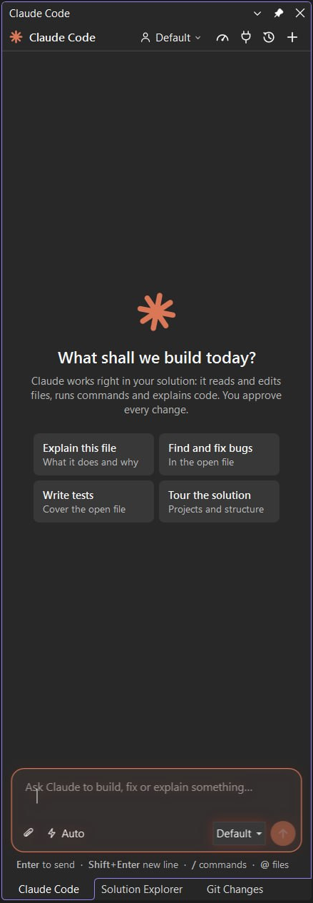
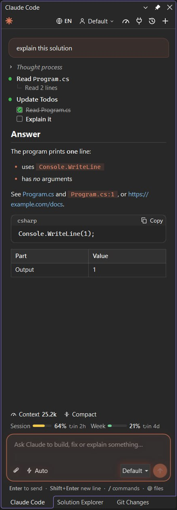
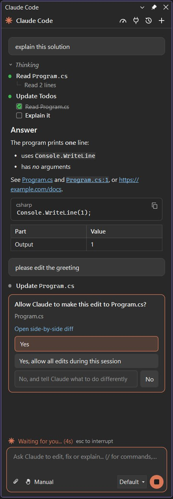

# Claude Code for Visual Studio

Claude Code in a Visual Studio tool window. It runs the Claude Code CLI you already use, in your solution folder, so
your sign-in, settings, `CLAUDE.md`, permissions and MCP servers all apply, just as in a terminal.

| | | |
|:-:|:-:|:-:|
|  |  |  |
| **Start** from a suggestion or your own prompt | **Follow** every step, the context and your limits | **Approve** each edit and command |

## Requirements

- Visual Studio 2022 (17.14 or later) or Visual Studio 2026.
- The Claude Code CLI, signed in. Install it in PowerShell with
  `irm https://claude.ai/install.ps1 | iex`, then run `claude` once to sign in. If `claude.exe` is somewhere else, point
  the `VSL_CLAUDE_PATH` environment variable at it.

## Getting started

- Open the window with **Alt+K**, the Claude button on the Standard toolbar, or **View > Other Windows > Claude Code**.
- **Ask Claude** in the code editor's context menu sends the current file and selection with your prompt. On files,
  folders and projects in Solution Explorer it adds them to the prompt as `@` mentions.

## Features

- **Conversation**: streamed Markdown answers, tool calls with their results, todo lists, and subagent steps.
- **Approvals**: Claude asks before it edits files or runs commands. Answer Yes, allow edits for the session, or No
  with a note on what to do instead. A proposed edit opens in Visual Studio's diff window.
- **Questions and plans**: answer Claude's clarifying questions and approve or refine its plans in the panel.
- **Modes and models**: Manual, Edit automatically, Plan and Auto (Shift+Tab), reasoning effort, and the model picker.
- **Context**: the current file and selection, `/` commands, `@` files, and images by paste, drag and drop, or attach.
- **Tokens**: how much context the conversation holds, with Context (`/context`) and Compact (`/compact`), and your
  plan's session and weekly limits with when each resets.
- **Account and usage**, and **MCP servers** with their status, sign-in, enable / disable and Add server.
- **Several accounts**: each `~/.claude-NAME` folder is an account next to the default `~/.claude`, as with
  `CLAUDE_CONFIG_DIR` in a terminal. Add one from the picker and sign in.
- **History**: resume past conversations of the solution folder.
- File references in answers open in the editor at their line. The window follows the Visual Studio theme and speaks
  English or Uzbek (the globe button).

## Privacy

The extension itself sends nothing anywhere. It starts the `claude` CLI on your machine, and the CLI talks to
Anthropic exactly as it does in a terminal.

## About

Part of VSL (Visual Studio for Linux), whose Claude Code panel this is: the same CLI session, protocol and view model,
with a WPF view for Visual Studio. MIT licensed.
